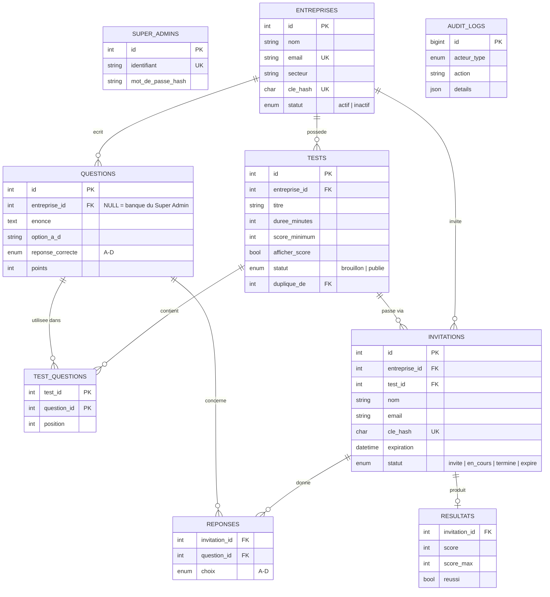

# Base de données PsyTech Pro



## Qui utilise quoi
| Module | Tables principales |
|---|---|
| Super Admin | `super_admins`, `entreprises`, `questions` (entreprise_id NULL), `audit_logs`, stats sur tout |
| Entreprise (RH) | `tests`, `questions` (les siennes), `test_questions`, `invitations`, vues `v_tests_resume`, `v_resultats_detail`, `v_dashboard_entreprise` |
| Candidat | `invitations` (login par clé), `test_questions` + `questions` (énoncés), `reponses`, `resultats` |

## Requêtes utiles
**Questions d'un test, dans l'ordre** (sans la bonne réponse pour le candidat !):
```sql
SELECT q.id, q.enonce, q.option_a, q.option_b, q.option_c, q.option_d
FROM test_questions tq JOIN questions q ON q.id = tq.question_id
WHERE tq.test_id = ? ORDER BY tq.position;
```
**Calcul du score à la soumission:**
```sql
SELECT COALESCE(SUM(CASE WHEN r.choix = q.reponse_correcte THEN q.points END), 0) AS score,
       SUM(q.points) AS score_max
FROM test_questions tq
JOIN questions q ON q.id = tq.question_id
LEFT JOIN reponses r ON r.question_id = q.id AND r.invitation_id = ?
WHERE tq.test_id = ?;
```
**Enregistrer/changer une réponse** (le candidat peut revenir en arrière):
```sql
INSERT INTO reponses (invitation_id, question_id, choix) VALUES (?, ?, ?)
ON DUPLICATE KEY UPDATE choix = VALUES(choix);
```
**Login candidat** (clé valide, non expirée, entreprise active):
```sql
SELECT i.* FROM invitations i JOIN entreprises e ON e.id = i.entreprise_id
WHERE i.cle_hash = ? AND i.expiration > NOW() AND e.statut = 'actif' AND i.statut <> 'termine';
```
La clé reçue est hashée avec `hashKey()` de `src/utils/keys.js` avant la requête.
